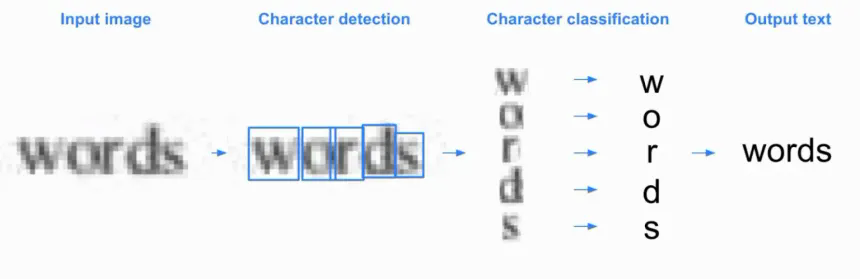

# PaddleOCR on phyBOARD-Pollux (i.MX8M Plus NPU)

Real-time, on-device OCR running on the **phyBOARD-Pollux** (NXP i.MX 8M Plus) using the
**PP-OCRv6 tiny** detection and recognition models from PaddleOCR, converted to TensorFlow Lite.
Text detection runs on the board's **NPU** (VX delegate); text recognition runs on the CPU.
A Dell 2K USB webcam is used as the live input, with an OpenCV preview window.

## Results

|  |
|:--:|
| *OCR pipeline: input image → detection → classification → output text* |

|  |
|:--:|
| *Text detection: the detector finds each word/line box, then the recognizer reads it* |

### Measured performance (on board)

| Scenario | Result |
|---|---|
| Display / camera loop | **20+ FPS** on average |
| OCR latency, 4–5 sentences in view | **~500 – 600 ms** per OCR cycle |
| OCR latency, full page of text | **up to ~2000 ms** per OCR cycle |

The display loop and the OCR loop run in separate threads, so the preview stays smooth
(20+ FPS) while OCR results refresh at their own rate. Latency grows with the number of
detected text regions, because each region is cropped and recognized one by one.

## Test setup

| Item | Details |
|---|---|
| Board | phyBOARD-Pollux (i.MX 8M Plus) |
| RAM | 1.89 GB usable |
| Camera | Dell 2K webcam (V4L2, MJPG) |
| OS image | PHYTEC BSP-Yocto-CelebrityFaceMatch-i.MX8MP-v0.7 ([release notes](https://download.phytec.de/Software/Linux/BSP-Yocto-CelebrityFaceMatch/BSP-Yocto-CelebrityFaceMatch-i.MX8MP-v0.7/ReleaseNotes)) |
| Runtime | TFLite (`tflite_runtime` ) + VX delegate (`/usr/lib/libvx_delegate.so`) |

## Models

Source models are from the official PaddlePaddle Hugging Face repositories (ONNX), converted to TFLite for the board:

| Stage | Source (Hugging Face) | File in this repo | Precision | Runs on |
|---|---|---|---|---|
| Detection | [PaddlePaddle/PP-OCRv6_tiny_det_onnx](https://huggingface.co/PaddlePaddle/PP-OCRv6_tiny_det_onnx) | `models/det_int8.tflite` (~519 KB) | INT8 | NPU |
| Recognition | [PaddlePaddle/PP-OCRv6_tiny_rec_onnx](https://huggingface.co/PaddlePaddle/PP-OCRv6_tiny_rec_onnx) | `models/inference_rec_logits_float32.tflite` (~4.3 MB) | FP32 | CPU |

`rec_dict.txt` is the character dictionary for the recognizer (6904 characters; the code adds a CTC blank at index 0 and a space at the end).

## Project layout

```
paddle-ocr-phyBOARD/
├── main.py          # live camera OCR application
├── rec_dict.txt     # recognition character dictionary
├── models/
│   ├── det_int8.tflite
│   └── inference_rec_logits_float32.tflite
└── data/            # result / illustration images
```

## How it works

1. **Camera thread** – grabs frames via V4L2 (MJPG for higher FPS) and always keeps only the newest frame, so there is no buffer lag.
2. **OCR worker thread** – for each new frame:
   - **Detection**: resize to 640×640, normalize, run the INT8 model on the NPU, threshold the probability map, find contours, build rotated boxes and expand them (DB post-processing, unclip 1.8).
   - **Crop**: perspective-warp each box to a straight text strip (rotated if it is taller than wide).
   - **Recognition**: resize to 48×320, run the CRNN model, CTC greedy decode with the dictionary.
3. **Tracking and voting** – boxes are matched across frames by IoU; each box keeps its last 8 reads and shows the best one (highest confidence with a bonus for repeats). This removes flicker and improves accuracy.
4. **Display loop** – draws boxes, text labels, FPS and OCR time using OpenCV (PIL is only used for non-ASCII labels). It never waits for OCR.

## Run

Install the dependencies on the board:

```bash
pip3 install numpy opencv-python pillow
# plus one of: tflite_runtime  or  ai_edge_litert
```

Start the app:

```bash
python3 main.py                    # defaults: camera 0, NPU delegate
python3 main.py --hd               # capture at 1280x720
python3 main.py --cam 1            # choose another camera index
python3 main.py --delegate ""      # no delegate, run everything on CPU
python3 main.py --font /path/to/font.ttf   # font for non-ASCII text
```

Press **q** or **Esc** to quit.

| Option | Default | Description |
|---|---|---|
| `--det` | `models/det_int8.tflite` | Detection model |
| `--rec` | `models/inference_rec_logits_float32.tflite` | Recognition model |
| `--dict` | `rec_dict.txt` | Character dictionary |
| `--cam` | `0` | Camera index |
| `--hd` | off | Capture at 1280×720 |
| `--threads` | `4` | CPU threads for TFLite |
| `--delegate` | `/usr/lib/libvx_delegate.so` | NPU delegate library |
| `--label-size` | `32` | Label font size |
| `--fps-size` | `36` | FPS overlay font size |
| `--font` | auto | TTF font for non-ASCII labels |

## Use cases and limits

- **Best fit: edge OCR with a camera** – reading a few lines or sentences (signs, labels, tags, small notes) live on the device, offline, at 20+ FPS preview and about 0.5–0.6 s OCR latency.
- **Dense pages are slower** – a full page of text takes up to ~2 s per cycle on this board.
- **Other uses: document OCR** – without a camera and without the OpenCV preview window, the same models can process scanned images or PDFs page by page. Without the live-video overhead the results should be good, since latency matters less there. This is not yet measured in this repo.

## Acknowledgements

- **[PaddleOCR](https://github.com/PaddlePaddle/PaddleOCR)** and the PaddlePaddle team for the PP-OCRv6 models (detection and recognition) and the ONNX releases on Hugging Face. Thank you for making high-quality OCR available for edge devices.
- **PHYTEC** for the phyBOARD-Pollux and the BSP-Yocto-CelebrityFaceMatch-i.MX8MP image.
- **NXP** for the i.MX 8M Plus NPU and the VX delegate.

## License

The PP-OCRv6 models are released by PaddlePaddle under their own license. Check the model pages linked above before using them in a product.
